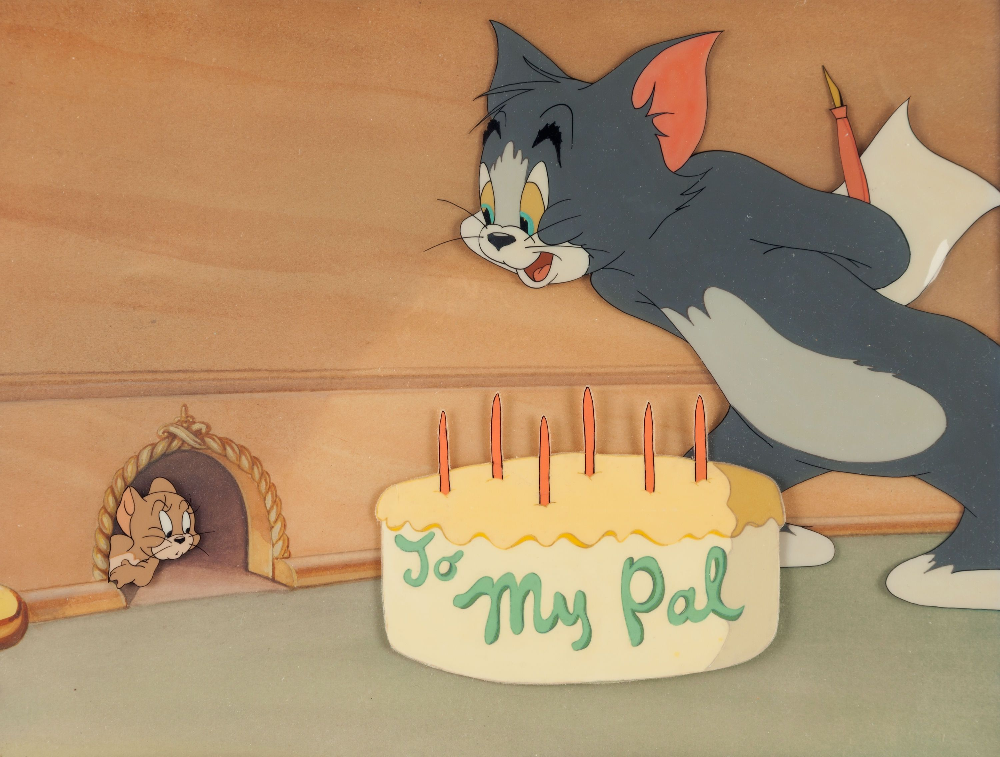

```text
git init
git remote add origin git@github.com:Abdalla194/proj2.git
git branch -M main
git add .
git commit -m "commit 1"
git branch
git push -u origin main
git branch dev
git branch test
git switch dev
git add .
git commit -m "commit 2"
git switch test
git add .
git commit -m "commit 3"
git switch main
git push -u origin dev
git push -u origin test
git switch main
git merge dev
git merge test
git push -u origin main
git switch dev
git stash
git switch test
git switch dev
git stash pop
git switch main
git branch -d dev
git branch -d test
git push --delete dev
git push origin --delete dev
git push origin --delete test
git tag -a v1.7 -m "Version 1.7"
git push origin v1.7
git push origin --tags
git tag
git tag -d v1.7
git push origin --delete v1.7
git add README.md images/bd.jpg
git commit -m "commit 4"
git push origin main
git add .
git commit -m "commit 5"
git push origin main
git add README.md images/bd.jpg
git commit -m "commit 6"
git add .
git commit -m "commit 6"
git push origin main
git add .
git commit -m "commit 7"
git push origin main
```